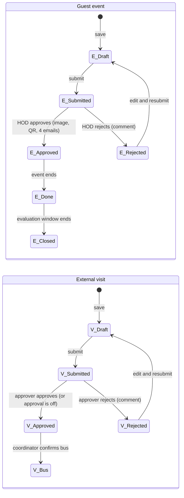
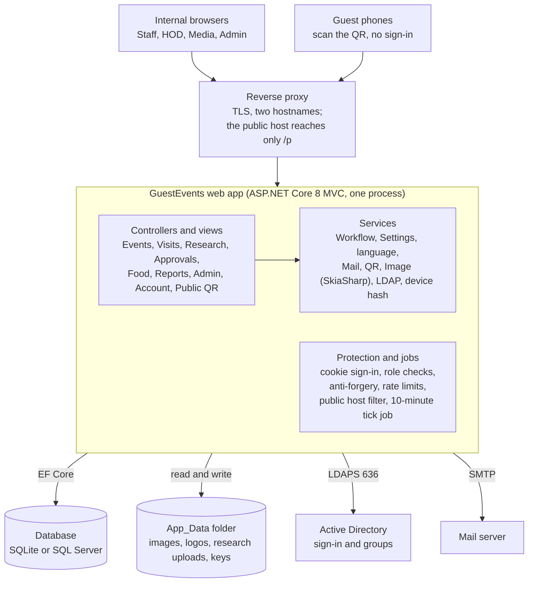

# Guest Events, External Visits & Research - Product Requirements

Last updated: 2026-10-24. See also [SETUP.md](SETUP.md), [USER-GUIDE.md](USER-GUIDE.md) and [SITEMAP.md](SITEMAP.md).

## 1. Overview

Guest Events is an internal web app that takes a guest workshop or a student bus trip from request to approval, notification and (for events) attendance and evaluation, and records research papers and proposals sent to the research in-charge, with one audit trail and full Arabic/English support.

**Problem.** Guest events and student trips are arranged by email and phone. Approvals are slow and untracked, the media team gets no image, attendance is on paper, and the transport office hears about trips too late.

**Product.** Three areas share one login, role model, settings page, mail engine and audit log:

- **Guest event request** - staff request an event with a company guest; the HOD approves; the system creates the event image and a QR code, emails the media officer, contact and admin, collects check-ins from the public QR page, and gathers anonymous evaluations. Staff can also request food for an approved event.
- **External visit (bus) request** - staff request a bus to take students off campus; a separately configured approver decides; a bus coordinator confirms the bus and enters bus details.
- **Research upload** - staff upload a research paper or proposal (PDF or Word); it is emailed to the research in-charge and kept in an archive. There is nothing to approve.

**Goals**

- One approval click triggers every follow-up (image, QR, emails) with no manual copying.
- Approvers, bus coordinators and email recipients are changeable by an Admin in Settings, with no code change.
- Sign in with the company email address and existing Active Directory password; no new passwords.
- Work in Arabic (right-to-left) and English, with optional Arabic digits.
- Every decision and settings change is written to an audit log.

**Non-goals (v1)**

- No bus fleet scheduling, route planning or driver app; the bus coordinator types bus details as free text.
- No parent consent forms or per-student rosters for visits.
- No external-user accounts; guests only use the public QR pages.
- No payment or budget tracking.
- No review, scoring or approval of research documents; the archive is a record, not a workflow.

## 2. Users and roles

Five roles cover everyone who signs in; guests never sign in and only see the public QR pages. A person gets a role from their Active Directory group, from an in-app role assignment made by an Admin, or both.

| Role | AD group (default) | Who | Can do |
|---|---|---|---|
| Staff | Events-Staff | Teachers and coordinators | Create, edit and submit event requests and external visits; request food for their approved events; upload research papers and proposals; see their own items |
| HOD | Events-HOD | Head of department | Approve or reject event requests; approve visits when no visit approvers are listed in Settings |
| Media | Events-Media | Media officer | View approved events and download the event image and QR |
| Research | Research-InCharge | Research in-charge | Receives every research upload by email; browses, searches and downloads the research archive. Nothing to approve or reject |
| Admin | Events-Admin | Administration / IT | Everything: reports, food confirmation, settings, roles, connections, audit log; can always approve visits, confirm buses and see the research archive |
| Guest (no login) | none | Event attendees | Check in and evaluate through the public QR link |

A role can come from **several** AD groups, and any person can also be given a role directly by email address or username.

**Visit permissions are separate from roles.** In Settings, an Admin lists the people (email or username) who approve visits and who confirm buses. Those people see every submitted visit and a badge of what is waiting for them. They still need one of the roles to be able to sign in.

| Action on an external visit | Requester | Listed approver | Listed bus coordinator | Admin |
|---|---|---|---|---|
| Create, edit, submit (draft or rejected) | Yes | Only if Staff | Only if Staff | Yes |
| View | Own | All submitted | All submitted | All |
| Approve or reject | No | Yes | No | Yes |
| Confirm bus and enter bus details | No | No | Yes | Yes |

**Research permissions.**

| Action on a research upload | Staff (uploader) | Research in-charge | Admin |
|---|---|---|---|
| Upload a paper or proposal | Yes | Only if also Staff | Yes |
| See the archive | Own uploads | All uploads | All uploads |
| Download a file | Own files | All files | All files |

## 3. Functional requirements

### A. Guest event requests

| ID | Requirement |
|---|---|
| EV-1 | Staff create an event with name, type (workshop, seminar, training, other), presenter, company, company logo (PNG/JPG up to 2 MB), contact name, email and phone, venue, expected attendees and bilingual content. |
| EV-2 | An event can be one day or up to 60 days; start and end times apply to every day. |
| EV-3 | Staff can save a draft and submit later; a rejected event can be edited and resubmitted. |
| EV-4 | The HOD sees pending requests, approves, or rejects with a mandatory comment. Only the HOD named in Settings can decide when one is set. |
| EV-5 | A reminder email goes to the HOD after a configurable number of working days (Sunday to Thursday). |
| EV-6 | On approval the system generates the event image (locked template, bilingual) and a QR code, then emails the media officer (image), the company contact (image), the admin mailbox and the requester. |
| EV-7 | Status rolls over automatically: Approved, Event done, Evaluation closed. |

### B. Attendance and evaluation (public QR pages)

| ID | Requirement |
|---|---|
| QR-1 | Guests scan the QR and check in with name and organization (email and phone optional or required by setting); one check-in per device per day. |
| QR-2 | Check-in opens and closes by configurable windows around the event time. |
| QR-3 | Optional protections: rotating QR on the venue screen (refreshes every 60 seconds), or allow check-in only from venue network prefixes. |
| QR-4 | After checking in, a guest submits an anonymous evaluation (1 to 5 ratings and comments). Attendance and evaluation use different device-hash salts and have no link between them. |
| QR-5 | The public host exposes only the check-in and evaluation pages; everything else returns 404 on that host. |

### C. Food requests

| ID | Requirement |
|---|---|
| FD-1 | The owner of an approved event requests food: people, meal type, delivery time, location, notes. |
| FD-2 | The request is emailed to the admin mailbox; Admin confirms or rejects it and the requester is emailed. |

### D. External visits (bus requests)

| ID | Requirement |
|---|---|
| XV-1 | Staff create an external visit: visit name, destination and address, purpose, date, departure and return time, pick-up point, grade or class, number of students, accompanying staff, supervisor name and phone, notes. |
| XV-2 | Return time must be after departure time. The date cannot be in the past; same-day requests are allowed. |
| XV-3 | Minimum notice (days before the trip) is configurable; 0 means no limit. |
| XV-4 | Approval is separate from event approval. An Admin chooses whether approval is required, and who approves (email or username; empty = anyone with the HOD role; Admin can always approve). |
| XV-5 | If approval is not required, a submitted visit goes straight to the bus step. |
| XV-6 | Approver rejection needs a comment; the requester can edit and resubmit. |
| XV-7 | After approval, the bus request email goes to the configured bus recipients (default: admin mailbox and extra admin recipients). |
| XV-8 | A bus coordinator (listed people, or Admin) confirms the bus and records bus details such as bus number, driver and phone. |
| XV-9 | The requester is emailed on approval, rejection and bus confirmation when that setting is on. |
| XV-10 | Approvers and bus coordinators see a badge on the External visits menu counting what waits for them. |

### E. Reports, sign-in and administration

| ID | Requirement |
|---|---|
| AD-1 | Reports per event and overall: attendance versus expected, evaluation averages, response rate, average by presenter; Excel export. |
| AD-2 | Settings page with tabs: Recipients, External visits, Research, Sign-in help, Approval and check-in, QR and public page, Event image, Evaluation, Email templates, Display. |
| AD-3 | Admin assigns in-app roles to users, and configures the LDAP and SMTP connections from the browser. |
| AD-4 | Audit log of submissions, decisions, settings changes and food, bus and research actions; a notifications log of every email sent with success or error. |
| AD-5 | Arabic and English interface with right-to-left layout, optional Arabic digits and configurable date format; built-in help pages. |
| AD-6 | On the LDAP & Email page an Admin presses Fetch groups from LDAP to list the directory's groups, then assigns groups to roles. A role box turns green when its groups exist and red when one does not. Nothing is saved until the Admin saves. |
| AD-7 | Forgot password: the sign-in page links to a page with a Reset my password button (a URL an Admin sets, such as a self-service portal) and an Ask IT form that emails the IT helpdesk. The app never stores or changes passwords. The answer is the same for every address, and one address can ask once every 10 minutes. |
| AD-8 | The LDAP & Email page has a Use standard defaults button (LDAPS 636, verify certificate, nested groups, default role group names, Base DN worked out from the server name) and a matching one for mail (port 587, STARTTLS). Test LDAP is a readiness report: connection and certificate, service account sign-in, Base DN, each role group, how many users have an email address, and any duplicate emails that would block email sign-in. |
| AD-9 | Role assignment workspace: each role takes one or several AD groups (any match gives the role, nested groups included when on). Members opens a group to show its people with email addresses and the groups inside it, as a tree or a flat list; Copy emails copies them. Preview people per role lists every person who would get each role and from which group, flags groups that do not exist, and lets an Admin add or remove a single person by email or username without any group. Display choices (emails, usernames, tree or flat) are remembered in the browser. Reads are capped (150 groups, 500 members a group, 6 levels). |

### F. Research uploads

| ID | Requirement |
|---|---|
| RS-1 | Staff upload a research paper or a research proposal with title, type, authors, a short summary and one file (PDF, DOC or DOCX). |
| RS-2 | The file type, its content header and its size are checked before saving; the size limit defaults to 20 MB and an Admin sets 1 to 25 MB. |
| RS-3 | Each upload is recorded with uploader, department, time, file name and size, and written to the audit log. |
| RS-4 | The upload is emailed to the research in-charge address (default: the admin mailbox) with the file attached. Files over 10 MB are not attached; the email points to the archive instead. |
| RS-5 | The archive shows whether the email went out (Sent or Not sent). |
| RS-6 | There is no approval step: nobody accepts or rejects an upload. |
| RS-7 | The Research role and Admin see all uploads, search them and download files; staff see only their own uploads. |
| RS-8 | The uploader can receive a receipt email (a setting). |

## 4. Workflows and status lifecycles

Both flows use the same pattern: draft, submit, decision, follow-up. On approval an event creates its image and QR and sends four emails; a visit sends the bus request email. If an Admin turns visit approval off, a submitted visit skips the decision and goes straight to Approved. A rejection always needs a comment and returns the request to its owner, who edits and resubmits the same record.

Research uploads have no lifecycle: one upload is saved, emailed to the research in-charge and archived, and nobody approves it.

## 5. Sitemap and navigation

See [SITEMAP.md](SITEMAP.md) for the diagram and every route.

The top bar shows My events, External visits, Research, Pending approvals (HOD only), Reports and Food requests (Admin only) and an Admin menu. A yellow New request button lets Staff and Admin start an event, an external visit or a research upload. The External visits link carries a badge for approvers and bus coordinators. The Research link opens the archive for the research in-charge and Admin, and a person's own uploads for staff.

## 6. Architecture

A single ASP.NET Core 8 MVC application serves both the internal site and the public QR pages; the proxy and the public host filter decide which face a request sees. Controllers call services; services read and write the database through Entity Framework Core, write generated files to App_Data, talk to Active Directory over LDAPS and send mail over SMTP. Visits reuse the same settings, mail, audit and role services as events, so the new feature added one controller, one table and a few views; research uploads did the same and added a folder of files.

| Layer | Technology |
|---|---|
| Web | ASP.NET Core 8 MVC, Razor views, Bootstrap 5.3 and Bootstrap Icons from a CDN |
| Data | Entity Framework Core 8 with SQLite (default) or SQL Server |
| Auth | LDAP via the Novell LDAP library, cookie authentication, optional Negotiate (Windows SSO) |
| Mail | MailKit over SMTP, every send logged in Notifications |
| Image and QR | SkiaSharp for the event image; a QR generator for the code |
| Excel | ClosedXML for report exports |
| Background | A hosted service that ticks every 10 minutes |

**Request flow for an external visit.** A staff member submits a visit; the app saves it, writes an audit row and emails the approver. The approver opens the link, decides, and the app emails the requester and the bus recipients; the bus coordinator confirms the bus and the requester gets the final email.

**Request flow for a research upload.** A staff member uploads a PDF or Word file; the app checks it, saves it under `App_Data/research` with a random name, writes a database row and an audit row, and emails the research in-charge with the file attached. The in-charge opens the archive, searches and downloads.

**Fetching groups.** An Admin on the LDAP & Email page presses Fetch groups; the app binds with the service account, lists every group under the Base DN, and returns the names to the page. Nothing is stored until the Admin saves the role-to-group choices.

## 7. Data model

The database holds 13 tables managed by Entity Framework Core. External visits and research uploads are standalone tables, so they do not touch the event tables.

| Table | Purpose | Key fields |
|---|---|---|
| Events | Guest event request | Name, Type, Presenter, CompanyName, ContactName/Email/Phone, Date, EndDate, StartTime, EndTime, Venue, ExpectedAttendees, ContentAr/En, Status, requester fields, SubmittedAt |
| Approvals | One row per HOD decision on an event | EventRequestId, ApproverUsername, Approved, Comment, DecidedAt |
| Images | Generated event image | EventRequestId (1:1), FilePath |
| QRCodes | QR token and time windows | EventRequestId (1:1), Token (unique), CheckInOpen, CheckInClose, EvaluationClose |
| Attendances | Check-ins | EventRequestId, FullName, Organization, Day, DeviceHash (salt A) |
| Evaluations | Anonymous ratings | EventRequestId, Overall, Presenter, Content, VenueOrg, Food, Comments, DeviceHash (salt B) |
| FoodRequests | Food order for an event | EventRequestId, People, Meal, DeliveryTime, Location, Status |
| Visits | External visit (bus request) | Name, Destination, Date, DepartureTime, ReturnTime, PickupLocation, StudentCount, StaffCount, SupervisorName/Phone, Status, DecisionBy, DecisionComment, BusDetails |
| Settings | Key/value configuration | Key, Value |
| Notifications | Log of every email | Recipient, Subject, Success, Error |
| RoleAssignments | In-app roles for people, by email or username | Username, Role (unique together) |
| AuditLogs | Who did what and when | User, Action, Details, At |
| ResearchDocs | Uploaded research paper or proposal | Title, DocType, Authors, Summary, OriginalFileName, FilePath, FileSize, uploader fields, UploadedAt, EmailSent |

| Entity | Statuses |
|---|---|
| Event | Draft, Submitted, Approved, Rejected, Event done, Evaluation closed |
| Food request | Submitted, Confirmed, Rejected |
| External visit | Draft, Submitted, Approved (bus pending), Bus confirmed, Rejected |
| Research upload | None: recorded and emailed on upload, with an EmailSent flag |

SQLite is the default database. SQL Server is supported by setting one configuration value. On start, the app creates missing tables, so existing databases pick up the Visits and ResearchDocs tables without a manual migration.

## 8. Security, privacy and non-functional requirements

The internal app and the public QR pages run as one application with two faces, and the public face is locked down to the two pages guests need.

| Area | Requirement |
|---|---|
| Sign-in | Active Directory over LDAPS (port 636) with a service account; the sign-in name is the company email address (the AD mail attribute), and the short username, `DOMAIN\user` and UPN also work; optional Windows single sign-on (Kerberos/NTLM) when the server is domain-joined. A Dev mode exists for local testing only. |
| Session | Cookie named `ge_auth`, HttpOnly, Secure, 30-minute sliding expiry. |
| Brute-force protection | After 5 wrong passwords for one name the app stops asking AD for 10 minutes; login is also rate limited per IP (default 20 per minute). |
| CSRF | Anti-forgery token validated on every POST. |
| Public host | When `App:PublicHost` is set, requests on that host reach only `/p`, static files and the language switch; all else returns 404. Public pages are rate limited (60 reads and 30 submits per minute per IP by default). |
| Anonymity | Attendance and evaluation hash the device with two different salts and share no key, so a rating cannot be traced to a check-in. |
| Secrets | LDAP and SMTP passwords saved from the browser are encrypted with ASP.NET Data Protection; keys live in `App_Data/keys` and use Windows DPAPI on Windows. Back up that folder with the database. |
| Uploads | Logo must be PNG or JPG, up to 2 MB, and its file header is checked, not only the extension. |
| Research files | Only PDF, DOC and DOCX; the file header must match the extension; size limited (default 20 MB). Stored under `App_Data/research` with a random name, never served as a static file. Download is allowed only to the uploader, the Research role and Admin, and each download is audited. |
| Group lookup | Fetch groups, group members and the per-role preview are Admin only, use the LDAP service account, read names and emails only (capped) and are audited where they change data. Results are shown on the page and not stored. |
| Forgot password | No password is stored or changed by the app; the answer is identical for every address; one request per address every 10 minutes. |
| Headers | nosniff, no-referrer and X-Frame-Options DENY on every response; HSTS outside Development. |
| Audit | Submissions, decisions, bus confirmations, research uploads and downloads, role changes and every settings change are logged with user and time. |
| Language | Arabic (right-to-left) and English, switched per browser by cookie. |
| Availability | Single-server deployment; a background job runs every 10 minutes for reminders and status roll-over. Target (an assumption to confirm): business-hours availability, daily database and `App_Data` backup. |
| Capacity | Designed for one school or department: hundreds of requests a year, not thousands of concurrent users (an assumption to confirm). |

**Privacy.** Guests give name and organization (email and phone optional). Student data in external visits is limited to counts, grade and the supervisor's contact; no student names are stored. Uploaded research files are visible only to their uploader, the research in-charge and Admin.

## 9. Setup and deployment

See [SETUP.md](SETUP.md) for the full guide: requirements, local run, production deployment, connecting the real directory, operating and troubleshooting.

## 10. Configuration reference

See [SETUP.md](SETUP.md#configuration-reference) for every first-run key and every Settings page option.

## 11. Open questions and roadmap

**Open questions**

- [ ] Should a same-day visit be blocked when the departure time has already passed?
- [ ] Is transport a separate team that needs its own role, instead of a list of people?
- [ ] Should visit emails become editable templates like the event emails?
- [ ] Should the requester be able to cancel an approved visit, and should the bus coordinator be told?
- [ ] Should the Media role see the External visits page? Today it sees only its own (empty) list.
- [ ] Confirm the availability and capacity targets in section 8; they are assumptions.
- [ ] Should the research in-charge also be allowed to upload, or only Staff?
- [ ] Should uploads be scanned for viruses and kept for a set number of years?
- [ ] Is a single research in-charge address enough? Several addresses are supported, separated by commas.

**Roadmap candidates**

| Priority | Item | Why |
|---|---|---|
| 1 | Departure-time check and cancel flow for visits | Closes the gaps in same-day and late changes |
| 2 | Visit email templates in Settings | Match the event emails; Arabic and English wording |
| 3 | Visit reminder to the approver after N working days | Same behavior as event approvals |
| 4 | Visits in Reports and Excel export | Counts by month, destination and approval time |
| 5 | Calendar view of approved visits and bus conflicts | Avoids two trips needing the same bus |
| 6 | Student roster and parent consent per visit | Only if the school requires it |
| 7 | Research: virus scan, retention rule and filters by type and year | Keeps the archive safe and usable as it grows |
| 8 | In-app password reset (needs delegated reset rights for the service account) | Today the app points to the company reset page or IT |
