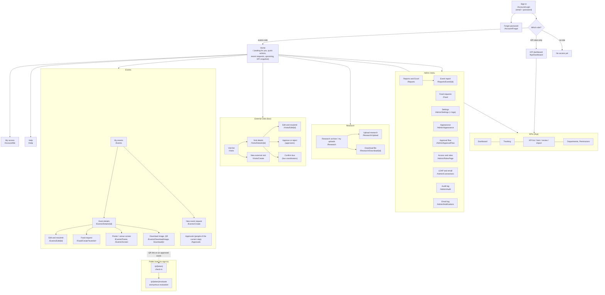

# Sitemap

Five work areas (events, visits, research, KPIs and admin) sit behind one sign-in, plus a public QR area on its own host. The top bar shows only what the signed-in person may use, and everyone lands on a page that fits their role. See also [USER-GUIDE.md](USER-GUIDE.md).

## Menu and who sees what

Top bar: **Home** · **My events** · **External visits** · **Research** (archive for the research in-charge and Admin) · **KPIs** · **Approvals** · **Admin** menu · the yellow **New request** button · Help · language · user menu (My access, Light / Dark / Auto, Text size, Sign out).

Admin menu: **Reports & Excel, Food request, Settings, Appearance, Approval flow, Access & roles, LDAP & Email, KPI entities, Import KPIs (Excel), Audit log, Notifications.**

| Menu item | Staff | HOD / Dean | Media | Research in-charge | KPI roles | Admin |
|---|---|---|---|---|---|---|
| Home | yes | yes | yes | yes | no (lands on KPIs) | yes |
| My events | own | all | approved | - | no | all |
| New request (event, visit, research) | yes | - | - | - | no | yes |
| External visits | own | approvers see all submitted | - | - | no | all |
| Research | own uploads | - | - | archive (all uploads) | no | archive |
| KPIs | read-only unless customized | read-only unless customized | read-only unless customized | read-only unless customized | by KPI role | all |
| Approvals | only if named or by role in an approval step | yes (default steps) | - | - | no | only if named in a step |
| Admin menu | - | - | - | - | - | yes |
| My access, Help, user menu switches | yes | yes | yes | yes | yes (Help opens the KPI page list) | yes |

Visit approvers and bus coordinators are chosen in **Settings > External visits (bus)**, so any person listed there also sees every submitted visit, whatever their role. Whether a role sees the **KPIs** menu at all is set by its KPI permissions (Admin > Access & roles, Customize).

## Routes

### Landing, access and account
| Route | Who | Purpose |
|---|---|---|
| `/` (`/Home`) | events-side roles | Home: waiting for you, quick actions, recent requests, upcoming events, KPI snapshot, Admin setup checklist. KPI-only roles are sent to `/Kpi/Dashboard`; people with no role see "No access yet" |
| `/Account/Me` | signed in | My access: roles, department, approval steps, what you can open and what each area needs |
| `/Account/Login` | anonymous | Sign in with the company email (or username, `DOMAIN\user`, UPN) and password; lists the test accounts in demo mode |
| `/Account/Forgot` | anonymous | Forgot password: reset button (URL from Settings) and the Ask IT form |
| `/Account/Sso` | anonymous | Windows single sign-on (only when `Auth:Sso` is on) |
| `/Account/Logout`, `/Account/Denied`, `/Home/Error`, `/lang` | any | Sign out, "your role cannot open this page", error page, language switch |
| `/brand/logo`, `/brand/font/{id}` | anyone | The uploaded logo and imported font files (shown on every page, including login and public pages) |

### Events
| Route | Who | Purpose |
|---|---|---|
| `/Events` | events-side roles | List (own events, or all for HOD, Dean and Admin) |
| `/Events/Create`, `/Events/Edit/{id}`, `/Events/Save` | Staff, Admin | Create, edit and submit an event request (with the searchable KPI picker) |
| `/Events/Details/{id}` | owner, approvers, Admin, Media (approved) | Details, history, downloads |
| `/Events/DownloadImage/{id}`, `/Events/DownloadQr/{id}` | owner, approvers, Admin, Media | Event image and QR code |
| `/Events/Poster/{id}`, `/Events/Screen/{id}` | Staff, Admin | Printable QR poster, venue screen (rotating QR) |
| `/Approvals` | anyone who may decide at a step | Requests waiting at a step the person may decide (and has not decided yet). The event is confirmed only after the last step approves |
| `/Food/Create?eventId=` | event owner, Admin | Food request for an approved event |
| `/Food` | Admin | Confirm or reject food requests |

### External visits
| Route | Who | Purpose |
|---|---|---|
| `/Visits` | events-side roles | Own visits; approvers, bus coordinators and Admin see all submitted |
| `/Visits/Create`, `/Visits/Edit/{id}`, `/Visits/Save` | Staff, Admin | Create, edit and submit |
| `/Visits/Details/{id}` | owner, approvers, bus coordinators, Admin | Details, decision and bus forms |
| `/Visits/Decide/{id}` | listed approvers (or HOD role), Admin | Approve or reject (comment required to reject) |
| `/Visits/ConfirmBus/{id}` | listed bus coordinators, Admin | Confirm the bus and save bus details |

### Research
| Route | Who | Purpose |
|---|---|---|
| `/Research` | Staff (own), Research in-charge and Admin (all) | Archive with search and download |
| `/Research/Upload` | Staff, Admin | Upload a paper or proposal (PDF, DOC, DOCX) |
| `/Research/Download/{id}` | uploader, Research in-charge, Admin | Download a file |

### Admin
| Route | Purpose |
|---|---|
| `/Reports`, `/Reports/Event/{id}` | Attendance and evaluation reports and live count |
| `/Reports/ExportEvents`, `/Reports/ExportVisits`, `/Reports/ExportEvaluations`, `/Reports/ExportAttendance/{id}` | Excel downloads (events with approval history, visits, evaluations, one event's attendance); the KPI report is `/Kpi/Reports/Export` |
| `/Admin/Settings`, `/Admin/UploadLogo`, `/Admin/RemoveLogo` | Settings tabs (Name, Recipients, External visits, Research, Sign-in help, Approval and check-in, QR and public page, Event image, Evaluation, Email templates, Audit log, Display) and the logo card |
| `/Admin/Appearance`, `/Admin/AppearanceCss`, `/Admin/UploadFont`, `/Admin/DeleteFont` | Colours and ready-made themes, light / dark mode, corners, fonts (built-in or imported) and text size, with a live preview |
| `/Admin/ApprovalFlow` | The approval chain: steps, order, who decides, approvals needed, extra email, on/off |
| `/Admin/RolesPage` | Access and roles: a card per role (who has it, events side, KPI permissions), add or remove people, department for the KPI officer, KPI role comparison |
| `/Admin/Connections` | LDAP and email: defaults, tests, fetch groups, members, per-role preview, direct assignment |
| `/Admin/Audit`, `/Admin/AuditExport`, `/Admin/AuditPurge` | Audit log: summary, filters, detail view, CSV / Excel export, clean-up |
| `/Admin/Notifications` | Log of every email sent |

### Public host (no sign-in)
| Route | Purpose |
|---|---|
| `/p/{token}` | Check in at an event (name and organization) |
| `/p/{token}/evaluate` | Anonymous evaluation after check-in |

## KPI pages (`/Kpi`)

Same sign-in, top bar, language, theme and fonts as the rest of the app. A tab bar at the top of each KPI page shows only what the person's permissions allow (it scrolls sideways on a phone).

| Route | Needs permission | What it does |
|---|---|---|
| `/Kpi` | any signed-in role | Sends you to the first KPI page you may open |
| `/Kpi/Dashboard` | dashboard.view | Charts and statistics (scoped to the department for a department KPI officer) |
| `/Kpi/Tracking` | tracking.view | Table of KPIs; assign departments and set targets, deadlines and status (needs tracking.edit.own, tracking.edit.all or tracking.assign) |
| `/Kpi/Reports/Export` | report.export | Excel execution report |
| `/Kpi/Admin/Kpis`, `/Kpi/Admin/KpiForm` | kpi.manage | List, add, edit, delete (kpi.delete) KPIs |
| `/Kpi/Admin/Review` | kpi.manage | Review items |
| `/Kpi/Admin/ImportExcel` | kpi.import | Excel import and template |
| `/Kpi/Admin/Entities` | entity.manage | KPI departments |
| `/Kpi/Admin/Roles` | role.manage | KPI roles and what each may do (a KPI role named like an app role applies to it) |
| `/Kpi/Help/SiteMap` | any | The KPI pages you can open |

KPI roles: **Kpi** (all-round team), **KpiManager**, **KpiEditor**, **KpiOfficer** (one department) and **KpiViewer**. The old KPI login, user and LDAP pages no longer exist: use the normal `/Account/Login`.
