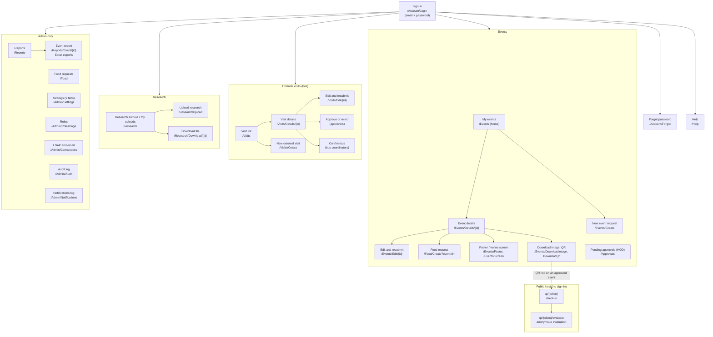

# Sitemap

Four work areas sit behind one sign-in, plus a public QR area on its own host. The top bar shows only what the signed-in person may use.

## Who sees what

| Menu item | Staff | HOD | Media | Research in-charge | Admin |
|---|---|---|---|---|---|
| My events | own | all | approved | - | all |
| New request (event, visit, research) | yes | - | - | - | yes |
| External visits | own | approvers see all submitted | - | - | all |
| Research | own uploads | - | - | archive (all uploads) | archive |
| Pending approvals | - | yes | - | - | - |
| Reports, Food requests, Admin menu | - | - | - | - | yes |
| Help | yes | yes | yes | yes | yes |

Visit approvers and bus coordinators are chosen in **Settings > External visits (bus)**, so any person listed there also sees every submitted visit, whatever their role.

## Routes

### Account (anonymous)
| Route | Purpose |
|---|---|
| `/Account/Login` | Sign in with the company email (or username, `DOMAIN\user`, UPN) and password |
| `/Account/Forgot` | Forgot password: reset button (URL from Settings) and the Ask IT form |
| `/Account/Sso` | Windows single sign-on (only when `Auth:Sso` is on) |
| `/Account/Logout`, `/Account/Denied`, `/lang` | Sign out, access denied, language switch |

### Events
| Route | Who | Purpose |
|---|---|---|
| `/Events` | all roles | List (own events, or all for HOD and Admin) |
| `/Events/Create`, `/Events/Edit/{id}`, `/Events/Save` | Staff, Admin | Create, edit and submit an event request |
| `/Events/Details/{id}` | owner, HOD, Admin, Media (approved) | Details, history, downloads |
| `/Events/DownloadImage/{id}`, `/Events/DownloadQr/{id}` | owner, HOD, Admin, Media | Event image and QR code |
| `/Events/Poster/{id}`, `/Events/Screen/{id}` | Staff, Admin | Printable QR poster, venue screen (rotating QR) |
| `/Approvals` | HOD | Pending event requests, approve or reject |
| `/Food/Create?eventId=` | event owner, Admin | Food request for an approved event |
| `/Food` | Admin | Confirm or reject food requests |

### External visits
| Route | Who | Purpose |
|---|---|---|
| `/Visits` | signed-in roles | Own visits; approvers, bus coordinators and Admin see all submitted |
| `/Visits/Create`, `/Visits/Edit/{id}`, `/Visits/Save` | Staff, Admin | Create, edit and submit |
| `/Visits/Details/{id}` | owner, approvers, bus coordinators, Admin | Details, decision and bus forms |
| `/Visits/Decide/{id}` | listed approvers (or HOD role), Admin | Approve or reject (comment required to reject) |
| `/Visits/ConfirmBus/{id}` | listed bus coordinators, Admin | Confirm the bus and save bus details |

### Research
| Route | Who | Purpose |
|---|---|---|
| `/Research` | Staff (own), Research in-charge and Admin (all) | Archive with search and download |
| `/Research/Upload` | Staff, Admin | Upload a paper or proposal (PDF, DOC, DOCX) |
| `/Research/Download/{id}` | uploader, Research in-charge, Admin | Download a file |

### Reports and administration (Admin)
| Route | Purpose |
|---|---|
| `/Reports`, `/Reports/Event/{id}` | Attendance and evaluation reports, live count, Excel exports |
| `/Admin/Settings` | Nine tabs: Recipients, External visits, Research, Sign-in help, Approval and check-in, QR and public page, Event image, Evaluation, Email templates, Display |
| `/Admin/RolesPage` | Give a role to an email address or username |
| `/Admin/Connections` | LDAP and email: defaults, tests, fetch groups, members, per-role preview, direct assignment |
| `/Admin/Audit`, `/Admin/Notifications` | Audit log, log of every email sent |

### Public host (no sign-in)
| Route | Purpose |
|---|---|
| `/p/{token}` | Check in at an event (name and organization) |
| `/p/{token}/evaluate` | Anonymous evaluation after check-in |
